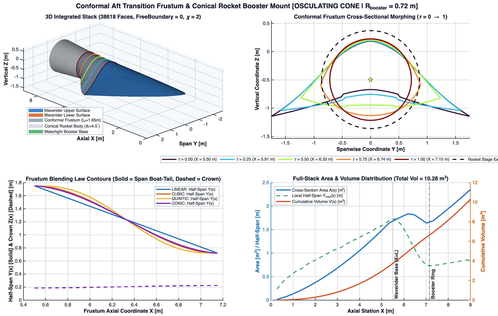
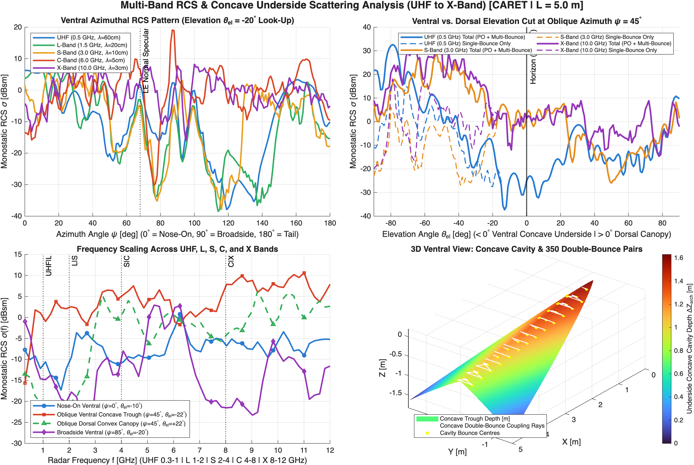
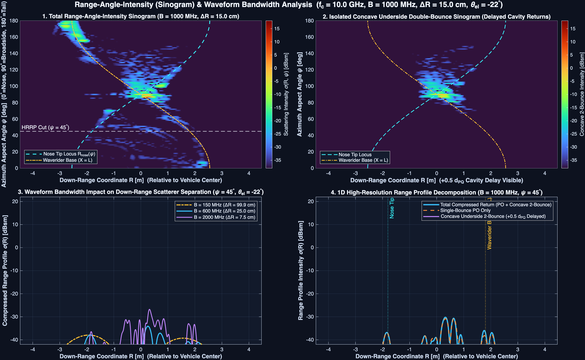

# Parametric Watertight Hypersonic Waverider & UHF–X Band RCS Studio

[](https://liploan.github.io/Hypersonics/)
[](https://liploan.github.io/Hypersonics/references.html)

A physics-validated MATLAB package (`+waverider/`) and zero-dependency client-side Web Studio (`docs/`) for generating, verifying, analyzing, visualizing, and exporting **2-manifold watertight 3D hypersonic waverider glide bodies**, **conventional axisymmetric reentry vehicles (RVs)** (mono-conic, bi-conic, and tri-conic architectures with conical, $C^1$ spherical, and $C^1$ ogive noses and flat or recessed concave aft bulkheads), **conformal aft rocket-booster transition frustums**, **full-polarimetric UHF-to-X-band monostatic Radar Cross Section (RCS) signatures** (Gordon contour Physical Optics + vector dyadic Sutherland–Hodgman Geometric-Optics / Physical-Optics concave double-bounce across linear `HH`, `VV`, `HV`, `VH` and circular `PP`, `OP` channels), and **wideband Range–Angle–Intensity (RTI) / High-Resolution Range Profile (HRRP)** radar diagnostics.

* **Live Interactive Web Studio**: https://liploan.github.io/Hypersonics/
* **Interactive Verified Bibliography (24 Citations + BibTeX)**: https://liploan.github.io/Hypersonics/references.html
* **Technical Documentation Hub**: [`documentation/README.md`](documentation/README.md)
* **GitHub Repository**: https://github.com/liploan/Hypersonics





---

## Highlights & Capabilities

1. **Four Physics-Based Waverider Families**:
   - **Axisymmetric Cone-Derived (`'conical'`)**: Integrates the exact axisymmetric irrotational **Taylor–Maccoll ODE** (`+waverider/+flow/taylorMaccoll.m`, `docs/physics.js`) inward from the generating shock cone $\theta = \beta$ to $\theta = \theta_c$ and traces 3D streamlines along exact meridian planes from the conical shock sheet.
   - **Sobieczky Inverse Osculating Cones (`'osculating_cone'`)**: Parameterizes the aft Inlet Capture Curve (ICC) with a flat centerbody shock segment and $C^2$-regularized power-law outer shock wings, tracing local Taylor–Maccoll streamlines in osculating planes with a differential-geometry **evolute caustic guard** ($d_{\text{LE}} \le 0.82\,R_c$) that prevents osculating-plane intersection.
   - **Nonweiler Caret / Planar Wedge (`'caret'`)**: Uses exact Rankine–Hugoniot $\theta$-$\beta$-$M$ oblique-shock relations (`+waverider/+flow/obliqueShock.m`) to construct planar compression facets satisfying $C_L = C_{p,2}$, $C_{D,\text{wave}} = C_{p,2}\tan\delta$, and $L/D = \cot\delta$ to machine precision.
   - **Kulfan CST Boost-Glide Body (`'cst'`)**: Uses Bernstein Class-Shape Transformation polynomials (`+waverider/+geometry/generateCSTBody.m`) longitudinally and spanwise with modified Newtonian + Prandtl–Meyer surface pressures.

2. **Conventional Axisymmetric Reentry Vehicles (`Method = 'rv'`)**:
   - **Multi-Conic Outer Mold Lines (`'mono_conic'`, `'bi_conic'`, `'tri_conic'`)**: Supports stabilizing aft tapers ($\theta_2 < \theta_1$) and aerodynamic control flares ($\theta_3 > \theta_2$) with configurable stage axial fractions (`+waverider/+geometry/generateReentryVehicle.m`).
   - **Nose Geometries (`'conical'`, `'spherical'`, `'ogive'`)**: Exact sharp cones solved via inverse Taylor–Maccoll ($\beta(M_\infty, \theta_1)$), $C^1$-tangent sphere-cones with Billig bow-shock standoff, and $C^1$-tangent circular-arc ogives.
   - **Flat or Recessed Concave Aft Bulkheads (`'flat'`, `'concave'`)**: Power-law recessed aft domes $X_{\text{aft}}(u) = L - d_{\text{aft}}(1 - u^p)$ with automatic positive-wall-thickness clamping, polar-to-polar genus-0 stitching ($\chi = 2$), and full GO-PO retroreflection / delayed cavity HRRP modeling.

3. **Conformal Aft Booster Frustum & Guaranteed 2-Manifold Watertight Topology**:
   - Smoothly morphs the non-axisymmetric waverider trailing-edge contour (or RV aft rim) at $X = L$ into a circular booster adapter ring of radius $R_b$ over length $L_f$ (`'cubic'`, `'quintic'`, `'linear'`, `'conic'` blending laws) centered at the exact area-weighted base centroid, optionally followed by a conical rocket stage (`+waverider/+geometry/appendConformalFrustum.m`).
   - Mirror-symmetric & polar triangulation (`+waverider/+geometry/stitchWatertightMesh.m`) guarantees exact bilateral symmetry ($|C_Y| < 10^{-15}$), zero free boundary edges, directed half-edge cancellation across every shared edge, Euler characteristic $\chi = V - E + F = 2$, zero degenerate triangles, and generalized winding number $W(\mathbf{q}) \in \{0, 1\}$ everywhere in $\mathbb{R}^3 \setminus \partial\mathcal{M}$.

4. **Full-Polarimetric UHF–X Band Coherent RCS & Wideband RTI / HRRP Signal Processing**:
   - **Single-Bounce Physical Optics (`+waverider/+rcs/facetPhaseIntegral.m`)**: Exact closed-form Gordon (1975) polygon contour phase integral with shared vertex phasors and zero mesh-density-dependent damping factors.
   - **Full-Polarimetric Vector GO-PO Concave Double-Bounce (`+waverider/+rcs/doubleBounceGOPO.m`)**: Geometric-Optics / Physical-Optics (GO-PO) Shooting-and-Bouncing-Rays exit-aperture solver using exact Sutherland–Hodgman convex quad clipping and full $2\times 2$ vector PEC reflection/radiation dyadics across linear (`HH`, `VV`, `HV`, `VH`) and circular (`PP` opposite-sense, `OP` same-sense) polarizations—adding $< 3\%$ compute overhead because ray culling, polygon clipping, and contour phase integration are shared across all channels.
   - **Wideband Stepped-Frequency / Matched-Filter HRRP & RTI (`+waverider/+rcs/computeRangeProfile.m`)**: Down-range resolution $\Delta R = c/(2B)$, analytical Harris (1978) spectral window point-spread functions (`'rect'`, `'hann'`, `'hamming'`), physical positive-frequency guard $B \le f_c$, $+0.5\,d_{PQ}$ cavity path-delay range migration, and polarimetric odd-bounce suppression (`OP`, `HV`/`VH`).

---

## Independent Verification Summary

All solvers in both MATLAB (`+waverider/`) and JavaScript (`docs/physics.js`) are verified against analytical theorems and independent numerical benchmarks:

| Validation Suite | Checks | Scope & Key Quantitative Benchmarks |
| :--- | :---: | :--- |
| [`tests/test_waverider_suite.m`](tests/test_waverider_suite.m) | **16 / 16 PASS** | Waverider & RV preset instantiation, 2-manifold edge pairing, $\chi = 2$, STL/OBJ export integrity |
| [`tests/test_physics_validation.m`](tests/test_physics_validation.m) | **33 / 33 PASS** | Taylor–Maccoll vs. SciPy ($\max\lvert\Delta\theta_c\rvert = 4.3\times 10^{-6\circ}$) & NACA-1135 ($\beta = 37.796^\circ$ vs. $37.80^\circ$); 42-config waverider + 19-config RV manifold & generalized winding number ($\max\lvert W-\{0,1\}\rvert=0.000$) + exact cone/paraboloid cavity volumes ($0.008\%$ / $0.156\%$); PEC plate $\mathrm{sinc}^2$ ($0.00\text{ dB}$), PEC sphere ($0.02\text{ dB}$), $90^\circ$ dihedral ($+0.03\text{ dB}$), circular-disk RV tail-on ($0.001\text{ dB}$); full Sinclair/circular polarimetry (`HH`, `VV`, `HV`, `VH`, `PP`, `OP`), concave RV aft retroreflection (`OP` $+13.29\text{ dBsm}$ vs. flat $-50\text{ dBsm}$, $+56\text{ cm}$ cavity HRRP delay); Nonweiler $L/D = \cot\delta$ ($1.3\times 10^{-14}$ error) |
| [`tests/web/validate_physics.mjs`](tests/web/validate_physics.mjs) | **36 / 36 PASS** | Full Node.js parity with all 33 MATLAB physics, polarimetry & RV checks plus sub-Mach & $B > f_c$ guardrails and $138\text{ ms}$ full-dashboard interactive frame budget |

---

## Quickstart

### 1. Interactive Web Studio (Browser / GitHub Pages)
Open **https://liploan.github.io/Hypersonics/** directly in any modern browser (the **Waverider** architecture tab opens by default; click the **Reentry Vehicle (RV)** tab in the sidebar to design mono-/bi-/tri-conic RVs with flat or concave aft bulkheads), or serve `docs/` locally:
```bash
npx serve docs
```
To run the standalone 36-check Node.js physics, topology, polarimetry & RV validation suite:
```bash
node tests/web/validate_physics.mjs
```

### 2. MATLAB Package (`R2022b+`, tested on `R2026b`)
```matlab
% 1. Add project root to MATLAB path
setup_waverider();

% 2. Build a preset or custom watertight waverider + conformal booster adapter
cfg = waverider.WaveriderConfig( ...
    'Method', 'osculating_cone', ...
    'Mach', 7.0, ...
    'ShockAngleDeg', 13.5, ...
    'Length', 5.5, ...
    'HalfSpan', 1.75, ...
    'PlanformPower', 0.62, ...
    'LeadingEdgeAnhedralDeg', 8.5, ...
    'UpperSurfaceType', 'canopy', ...
    'CanopyHeightRatio', 0.045, ...
    'EnableAftFrustum', true, ...
    'FrustumLength', 1.65, ...
    'BoosterRadius', 0.72, ...
    'FrustumBlendLaw', 'cubic', ...
    'EnableRocketStage', true, ...
    'RocketConeAngleDeg', 4.5);

body = waverider.WaveriderBody(cfg);
body.printSummary();

% 3. Generate aerodynamic, geometric, polarimetric RCS, and wideband RTI visualizations
body.plot();
body.plotKeyAttributes();
body.plotRCS('Polarization', 'HH');
waverider.viz.plotRangeAngleIntensity(body, ...
    'CenterFreqGHz', 10.0, 'BandwidthMHz', 1000, ...
    'ElevationDeg', -22, 'CutAzimuthDeg', 45, ...
    'WindowType', 'hann', 'Polarization', 'OP');

% 4. Export watertight CAD/CFD/CEM meshes
body.exportSTL('output/waverider_booster_watertight.stl');
body.exportOBJ('output/waverider_booster_watertight.obj');

% 5. Or build a conventional axisymmetric bi-conic Reentry Vehicle with concave aft bulkhead
rvBody = waverider.WaveriderBody('rv_biconic'); % also 'rv_monoconic', 'rv_triconic_flare', 'rv_sharp_conic'
rvBody.printSummary();
rvBody.plotRCS('Polarization', 'OP');

% 6. Run unit and physics validation suites
run('tests/test_waverider_suite.m');
run('tests/test_physics_validation.m');
```

---

## Repository Architecture & Documentation Map

```text
Hypersonics/
├── setup_waverider.m                    % Adds repository root to MATLAB path
├── README.md                            % Project overview & quickstart
├── documentation/                       % Comprehensive technical manuals
│   ├── README.md                        % Documentation index & reading guide
│   ├── THEORY_AND_METHODS.md            % Governing equations, frames, numerics & scope
│   ├── MATLAB_API_REFERENCE.md          % Complete +waverider class & function reference
│   ├── WEB_STUDIO_GUIDE.md              % Client-side physics engine & UI architecture
│   ├── VALIDATION_REPORT.md             % Independent benchmarks & reproduction guide
│   └── REFERENCES.md                    % 24 primary-source verified citations & BibTeX
├── +waverider/                          % MATLAB object-oriented package
│   ├── WaveriderConfig.m                % Parametric configuration & physical validators
│   ├── WaveriderBody.m                  % Surface lofting, aero, mesh audit & exporters
│   ├── +flow/                           % obliqueShock, taylorMaccoll, traceStreamline
│   ├── +geometry/                       % Conical, Osculating, Caret, CST, RV, Frustum, Stitcher
│   ├── +mesh/                           % verifyWatertight, exportSTL, exportOBJ
│   ├── +rcs/                            % facetPhaseIntegral, doubleBounceGOPO, computeRCS, RTI
│   └── +viz/                            % 9 multi-panel engineering & radar plotters
├── docs/                                % GitHub Pages Web Studio & Interactive Bibliography
│   ├── README.md                        % Web Studio local hosting & architecture notes
│   ├── index.html                       % 6-panel interactive 3D Waverider, RV & RCS Studio
│   ├── references.html                  % Searchable/filterable 24-citation bibliography
│   ├── physics.js                       % Standalone UMD gas-dynamic, mesh & CEM solver
│   ├── app.js                           % Tiered rAF UI controller & 2D/3D canvas renderers
│   ├── styles.css                       % Accessible dark/light theme & responsive layout
│   └── assets/                          % High-resolution MATLAB R2026b verification figures
├── examples/                            % 7 standalone MATLAB demonstration scripts
│   └── README.md                        % Guide to running & customizing example scripts
└── tests/                               % MATLAB & Node.js automated verification suites
    ├── README.md                        % Test suite documentation & pass criteria
    ├── test_waverider_suite.m           % 16-check MATLAB unit & topology suite (Waveriders + RVs)
    ├── test_physics_validation.m        % 33-check MATLAB physics, CEM, polarimetry & RV suite
    └── web/validate_physics.mjs         % 36-check Node.js Web Studio physics, polarimetry & RV suite
```

---

## Modeling Scope & Key Physical Assumptions

* **Gas Dynamics & Aerodynamics**: Perfect-gas ($\gamma = 1.4$) attached conical/planar shock theory at $\alpha = 0^\circ$ design point; off-design angle-of-attack polars use facet-calibrated modified Newtonian impact + Prandtl–Meyer leeward expansion + Eckert (1955) $30\text{ km}$ reference-temperature compressible turbulent skin friction (real-gas dissociation, shock–boundary-layer interaction, and leading-edge bluntness entropy layers require Navier–Stokes CFD).
* **Electromagnetics, Polarimetry & Wideband Radar**: High-frequency asymptotic Physical Optics + vector dyadic two-bounce Geometric-Optics / Physical-Optics (`Mean`, `HH`, `VV`, `HV`, `VH`, `PP`, `OP`) on a perfectly electrically conducting (PEC) airframe without multi-body shadow z-buffering beyond pairwise mutual visibility, creeping waves, or dielectric RAM/plasma coatings. Stepped-frequency HRRP/RTI evaluates scatterer amplitudes at $f_c$ across bandwidth $B \le f_c$. See [`documentation/THEORY_AND_METHODS.md`](documentation/THEORY_AND_METHODS.md) for full details.
